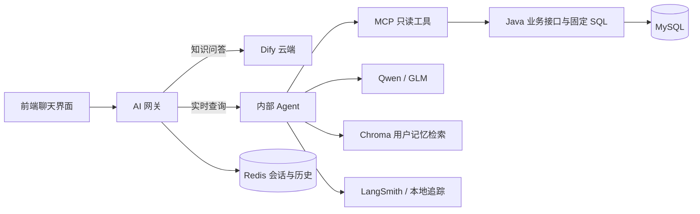

# 今天改造 Agent 工作流的一点心得

# 拆解影院项目的 AI 系统：从 Dify 网关到可控的只读 Agent

最近，我把影院项目里的 AI 部分从头梳理了一遍。最初看起来，它像是在聊天模型外面包了一层 Java 查询接口；深入代码后，才发现整条链路已经包含了独立网关、身份校验、意图识别、工具调用、结果验证、用户记忆和调用追踪。

理解这样的系统，关键不是只看“用了哪个模型”，而是看一个问题从浏览器发出后，如何安全地变成查询，又如何保证模型回答的内容有数据依据。

## 一、AI 系统不是一个模型，而是一条服务链路

项目目前有两个独立的聊天通道：Dify 知识问答和内部实时 Agent。前端通过 AI 网关访问它们，浏览器不直接持有 Dify 的密钥，也不直接访问内部 Agent 或数据库。



网关负责用户身份、会话归属、请求限流、并发控制、停止生成、SSE 事件转换和反馈保存。Agent 负责理解问题、规划查询步骤、调用工具并核对结果。Java 则负责真正的业务查询和规则计算。

这个分工意味着：模型能帮助系统理解用户在问什么，但不会因此获得数据库的任意读写权限。

## 二、网关先确认“是谁在问”

聊天请求会带上当前标签页的登录 token、会话绑定键和会话 ID。网关向 Java 核验登录身份，再通过 Redis 确认该绑定键和会话属于当前账号。

Agent 通道还要额外核验 Java 签发的短期转接凭证，并确认凭证中的用户、会话和查询范围与当前请求一致。浏览器不能通过提交一个 `userId` 来指定要查询谁的数据。

网关还用 Redis 管理历史记录、会话活动指针和分布式租约。这样多个网关 worker 可以协调同一会话，避免同一会话同时跑多个回答。用户停止生成时，前端会中断流，网关也会向上游传播取消信号。

回答结束也有明确条件：上游完成后，网关先保存消息快照和历史、释放租约，再向浏览器发出 `complete`。如果保存失败，前端不能把这轮请求显示成正常完成。

## 三、Agent 把自然语言变成有限的查询计划

内部 Agent 先进行规则解析和意图识别，再根据问题复杂度选择不同路径。它能识别影片、场次、座位、订单、退票、规则、推荐、闲聊和不支持的请求。

简单且信息完整的问题可以走 Simple 路径：由代码根据已验证的任务直接选择工具。多任务或带依赖的问题会走 ReAct 路径，让模型在工具结果之间提出下一步查询建议。

例如，用户问“明天这部电影还有座位吗”，系统需要先查场次，再根据查询结果确认是否只有一个候选场次。若场次不唯一，就请用户选择；若条件足够明确，才继续查询座位。模型不能凭空猜一个场次编号。

查询范围也需要分清：

- `catalog` 是影片资料目录。
- `showing` 表示上映状态。
- `scheduled` 表示存在实际排期。
- `bookable` 表示当前满足购票条件。

上映中的电影不一定有排期；已排期的场次也不一定现在能买。只要把这些概念混成一个“正在上映”，就容易答错用户的问题。

## 四、工具返回结果后，还要经过校验

Agent 的工具包含影片、场次、座位、本人订单、票务规则和推荐查询，也有一个用于追问用户的控制工具。当前模型没有下单、锁座、支付或退款的工具。

在真正调用工具前，代码会检查工具是否在白名单中、参数是否符合结构、查询条件是否越过用户请求、编号是否有可靠来源。订单号必须来自用户输入；场次编号必须来自用户明确提供的信息或本轮已经验证的查询结果。

影片、场次和订单查询通过 MCP 访问 Java。Java 使用固定接口和参数化 SQL 查询业务数据。本人订单查询会限定订单号和已核验的用户 ID，因此不能仅凭猜到别人的订单号读到对方信息。

工具返回后，Agent 还要检查结果结构和查询范围是否匹配。只有通过校验的数据，才会成为 Agent 后续组织答案的依据。

## 五、答案围绕事实生成，而不是自由编造

Agent 会把校验后的查询结果整理成事实块，再按问题组织回答。确定的简单问题可以由规则验证器检查；复杂问题最多再调用一次模型进行结构化反思，检查是否漏掉任务或包含没有数据支持的说法。

模型预算也有明确限制，包括模型调用次数、工具调用次数、执行步数、token 预留和时间期限。超过预算后，系统会停止继续调用，并尽量说明哪些结果已经确认、哪些部分尚未完成。

这也是“回答未完成”需要分层排查的原因。问题可能出在登录、会话绑定、模型调用、MCP、Java 查询、结果校验、流连接或 Redis 持久化中的任意一段，单看聊天页面上的提示无法确定根因。

## 六、项目里有三种不同的“记忆”

第一种是网关在 Redis 中保存的短期聊天历史。第二种是 Agent 单次运行时使用的任务、工具结果和预算状态。第三种是用户确认后保存的长期偏好。

长期记忆以 MySQL 为权威记录，Chroma 用来提供向量检索候选。用户说“记住我喜欢科幻电影”时，系统先向用户展示记忆建议；用户确认后，Java 写入记忆并创建索引任务，后台 worker 再把记忆同步到 Chroma。

检索时，Chroma 返回候选 ID 和版本，Java 会重新验证用户归属、启用状态和版本。这样即使旧向量尚未清理，已经删除或过期的记忆也不会直接成为有效回答依据。

偏好记忆适合辅助电影推荐。票价、场次、订单状态和退票资格仍要查询实时业务数据，不能拿旧记忆代替。

## 七、接入追踪不等于所有数据都不保存

项目可以在本地或预发环境启用 LangSmith，查看 Agent 节点、模型调用、工具调用、耗时和错误。追踪客户端会清洗数据，只保留允许的摘要和元信息，并把本地追踪按日期及用户会话归档。

但追踪脱敏和系统整体的数据保存是两回事：Redis 会保存短期聊天历史，用户提交反馈后 Java 会保存对应的反馈记录，长期记忆则保存用户确认的偏好。了解每种数据的用途和保存位置，才能正确评估排错能力与隐私边界。

## 总结

今天梳理后，我对这套 AI 系统的理解从“模型加接口”变成了一条有明确边界的查询流程：前端组织聊天，网关核验身份和管理会话，Agent 规划有限的只读操作，MCP 传递查询请求，Java 执行业务规则与 SQL，答案经过结果验证后返回。

目前 Dify 和 Agent 仍是两个独立通道，代码中还没有实现 Dify 失败后的自动转接和历史迁移。Agent 的正文也不是逐 token 输出，而是在查询和校验完成后统一返回。这些边界和功能一样重要：只有知道系统实际做到了什么，才能准确评估它的智能程度和后端压力。

**今天的产出：**完成了当前 AI 架构的代码梳理，整理了网关、Agent、MCP、记忆、反馈和追踪的实现说明，并制作了八张 SVG 图，供后续阅读和项目文档维护。

**关键词：** AI Agent、LangGraph、Dify、MCP、Redis、Chroma、LangSmith、影院系统

```text

```
