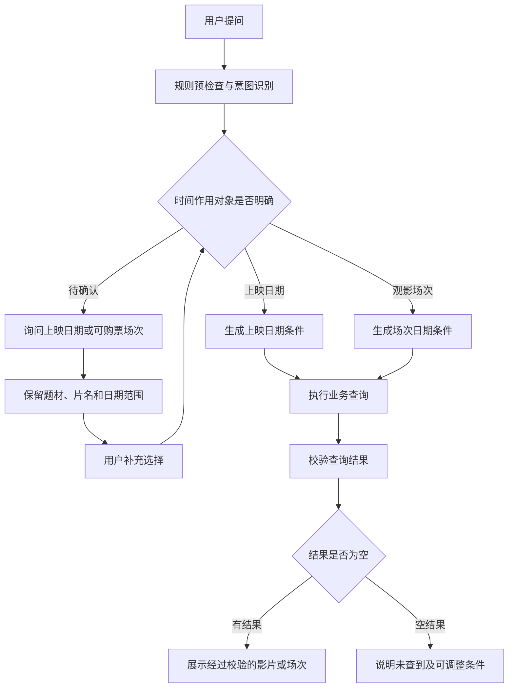

# 今天改造 Agent 工作流的一点心得

## 从一条空结果回答，排查影院 Agent 的时间理解问题

今天主要完善影院 Agent 的相对时间处理，并追踪了一条实际运行链路。

用户的问题是：

> 这周的悬疑题材电影有哪部？

系统回答：

> 观影日期：2026-10-12 至 2026-10-18（北京时间，含起止日）。以下影片具有符合条件的当前可订购场次。没有查到符合条件的影片，可以调整类型或扩大上映日期范围。

这段回答暴露了两个问题：用户没有明确要求查询可购票场次，系统却直接添加了观影日期条件；查询结果为空，回答又先声称存在符合条件的影片。

这次排查让我进一步意识到，时间处理不能只停留在日期换算，还要确认日期约束的是哪类业务数据。

## 一、日期算对了，查询含义仍然可能出错

以当天北京时间为基准：

- “最近一周”对应 2026-10-07 至 2026-10-13。
- “这周”对应自然周 2026-10-12 至 2026-10-18。
- “下周”对应自然周 2026-10-19 至 2026-10-25。

这条链路里的自然周范围计算正确，但“这周的电影”存在两种理解：

- 本周新上映的影片。
- 本周有可购票场次的影片。

第一种需要筛选影片的上映日期，第二种需要查询实际场次，并判断当前是否满足购票条件。

即使使用同一个日期范围，这两种查询的结果也可能完全不同。

## 二、问题出在规则解析和模型理解没有保持一致

检查 trace 和代码后发现，规则解析阶段先将问题识别为影片查询，并把“这周”转换成了场次日期条件。

随后，模型把最终意图识别为影片推荐，但代码仍然沿用规则阶段已经生成的时间条件。最终形成了这样的组合：

```text
最终意图：影片推荐
时间对象：场次日期
日期范围：2026-10-12 至 2026-10-18
```

这说明意图和时间条件分别经过了处理，却没有在形成最终查询计划时重新校验一致性。

本次调整后，最终意图确定后会重新校验时间语义。模型可以辅助理解问题，但添加上映日期或场次日期条件，必须有用户表达或已经确认的上下文作为依据。

## 三、为时间对象增加“待确认”状态

以前的处理容易在上映日期和场次日期之间直接选一个。现在增加了独立的待确认状态：

- `release`：上映日期。
- `screening`：场次日期。
- `unspecified`：时间作用对象尚未确认。

明确的表达直接进入对应查询：

- “本周新上映的悬疑片”按上映日期筛选。
- “本周有票的悬疑片”查询符合日期条件的可购票场次。
- “明晚能看的悬疑片”同时约束观影日期和晚间时段。

对于“这周的悬疑题材电影有哪部”，系统会先询问：

> 你想找本周新上映的悬疑片，还是本周有可购票场次的悬疑片？

确认前保留“悬疑”和已经计算出的日期范围，暂不生成业务查询任务。



## 四、追问需要继承条件，也要识别用户主动修改

时间澄清不能只解决当前一轮，还要让下一轮接得上。

用户回答“新上映的”时，系统继续使用上一轮的悬疑偏好和日期范围，只补全时间对象。回答“有票的”时，则切换到可购票场次查询。

这次检查还发现了一个衔接问题：“有票的”这种简短回复，会被原有的全量列表规则清空题材，导致“悬疑”丢失。修正后，时间选择回复会保留上一轮已确认的条件。

日期继承也区分两种情况：

- 用户只补充选择，即使跨周回复，也沿用上一轮实际展示的日期范围。
- 用户主动说“那下周呢”，按本轮北京时间重新计算日期，并继承已确认的时间对象和题材。

现有网站 Agent 网关会传入最近的有效问答历史，可以支持这类连续澄清。

## 五、日期条件需要一直传到实际查询

此前完成的相对时间归一化能力继续保留，包括具体日期、星期、自然周、滚动周、跨月跨年，以及上午、下午和晚间时段。

上映日期和场次日期使用不同的工具参数：

- 上映日期范围使用 `release_date_from/to`。
- 场次日期范围使用 `screening_date_from/to`。
- 早晚时段使用 `screening_hour_from/to`。

这些条件会传递到实际业务查询中，在数据库完成筛选或排序后，再限制返回数量。

“最好最近一周上映”属于软性偏好，可以优先返回范围内影片，并明确标注范围外的补充结果。“必须最近一周上映”属于硬条件，不能通过返回范围外影片来凑推荐数量。

## 六、空结果也需要明确的回答规则

这条链路的第二个问题来自固定回答模板。

模板先输出“以下影片具有符合条件的当前可订购场次”，之后才检查到返回列表为空，因此生成了前后矛盾的内容。反思阶段显示通过，也没有拦下这段文案。

现在调整为先判断结果是否为空：

- 有符合条件的场次，才输出肯定性的场次说明。
- 上映日期查询为空，提示调整题材或上映日期范围。
- 可购票场次查询为空，提示调整题材或观影日期。

同时保留业务边界：没有查到可购票场次，不能推导为没有排期。

空推荐结果的答复由程序固定生成，反思模型不能用自由改写替代这一判断。

## 七、验证结果与当前边界

本轮修改通过了 165 项 Python 离线回归，覆盖：

- 模糊时间先澄清，确认前不调用业务工具。
- 明确上映与可购票表达进入对应查询。
- 选择后保留题材、片名和日期。
- 跨周回复及后续日期追问。
- 模型不能自行添加时间作用对象。
- 空结果答复不包含肯定性前缀。
- 原有场次、座位、订单及工具边界保持有效。

扩大回归时，“空座”这类明确的座位表达曾被新规则误判。修复时复用了已有的场次和座位词义判断，避免推荐链路的调整影响座位查询。

此前后端日期筛选相关的 15 项 Java 隔离测试也已通过。本轮采用模拟模型和工具执行实际 Agent 图，尚未进行线上模型和网站实测，更新并重启内部 Agent 后才能验证网站中的实际表现。

## 总结

今天的改造把时间条件的处理延伸到了完整查询链路：先理解用户的查询目标，再确认时间作用对象，随后生成工具参数、执行业务筛选，最后按实际结果组织回答。

一条日期明确的回答，仍然可能使用了错误的筛选对象；一次正常完成的工具调用，也不代表答复已经符合用户意图。追踪时需要同时检查理解结果、查询条件、工具返回和最终文案。

**今天的产出：**完善相对时间归一化与时间对象澄清链路，修复选择回复丢失题材和空结果文案矛盾的问题，补充回归用例及实现说明，完成 165 项 Python 离线回归。

**关键词：** AI Agent、相对时间归一化、意图识别、多轮澄清、LangGraph、工具调用、结果校验、影院系统